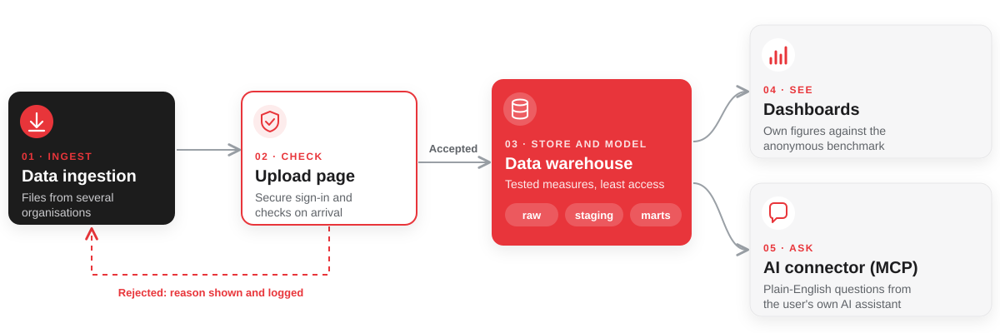

# Case study: a secure end-to-end data platform, from ingestion to AI insights

**Status:** in progress · **Duration:** 8 weeks · **Role:** sole consultant, from scoping to handover

By [Pablo Gomez](https://data.monster), Tableau Visionary and Tableau DataDev Ambassador · DataMonster

## The problem

A start-up needed to prove that its monthly benchmarking product could work from end to end: sensitive data arriving from several organisations, checked on arrival, turned into a small set of tested measures and delivered as dashboards and through AI assistants. Each organisation must only ever see its own figures against an anonymous benchmark.

The pilot runs on realistic synthetic data only and is built so the same platform can take real data once the business is funded.

## Architecture

Three principles shape it:

- **Rejected files never reach the warehouse.** Checks run on the page and the sender gets a clear reason in seconds.
- **Nothing is overwritten.** Every upload is kept and logged, so a file can be replaced and later restored.
- **Least access at every layer.** Loading, transforming and reporting each have their own role; small groups are hidden so no single organisation can be picked out.

## The stack and why

| Layer | Tool | Why this one |
| --- | --- | --- |
| Warehouse | **Snowflake** | Separate compute for loading and reporting, billed by the second and suspended after a minute idle, with a hard monthly spending cap. Role-based access, encryption and data kept in a chosen region come as standard, which matters for sensitive data |
| Transformation and tests | **dbt Core** | Every measure is plain SQL under version control, with tests that run on each build. Open source, so no licence cost while the business is unfunded |
| Upload page | **Next.js and TypeScript on Vercel** | A simple branded page for the people sending files, rather than the warehouse's own interface. Deploys automatically from GitHub and runs in a local region |
| Sign-in | **Microsoft Entra External ID** | A directory just for external users, kept apart from the client's own staff. Free at pilot scale, grows to thousands of users and adds a second sign-in step with no extra code. Fits a business already on Microsoft 365 |
| Synthetic data | **Python** | A realistic fictional dataset calibrated to public statistics, with an answer key, so the whole pipeline can be built and tested without any real data |
| Dashboards | **Fixed-layout dashboards** | Designed for desktop and phone from the start, with one meaning per colour and small groups hidden |
| AI layer | **Model Context Protocol (MCP)** | Lets each user ask questions from the AI assistant they already use, rather than a new tool, while the platform controls exactly what can be answered |
| Secrets | **A password manager** | Every login, key and recovery code in one place owned by the client, never in code or documents |
| Delivery | **GitHub, Notion and Claude** | Code and documentation side by side in GitHub; plan, decisions and tasks in Notion; Claude for planning, documentation and coding, with every step signed off by a person |

Every account is opened in the client's name from day one, so handover is simple and nothing depends on the consultant.

## Main lessons

- **Judge every option by what the end user sees.** A technically neat option failed because of what the people uploading files would see on screen.
- **Write the spec before the code.** A written file format and one clear rule (fix what can only mean one thing, reject what is ambiguous) made the checks simple to build.
- **Make synthetic data as close to the real thing as possible.** Calibrated to public statistics and checked by a domain expert, it lets the whole pipeline be built and tested properly before any real data arrives.
- **Build stories, not just pretty dashboards.** Decide which stories you want to tell and show in a demo, then shape the data and dashboards so those stories stand out.
- **Use AI with a human in charge.** AI drafts, documents and codes; every step is signed off by a person and documented as it is done.
