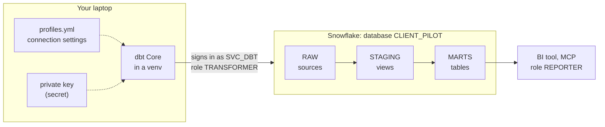
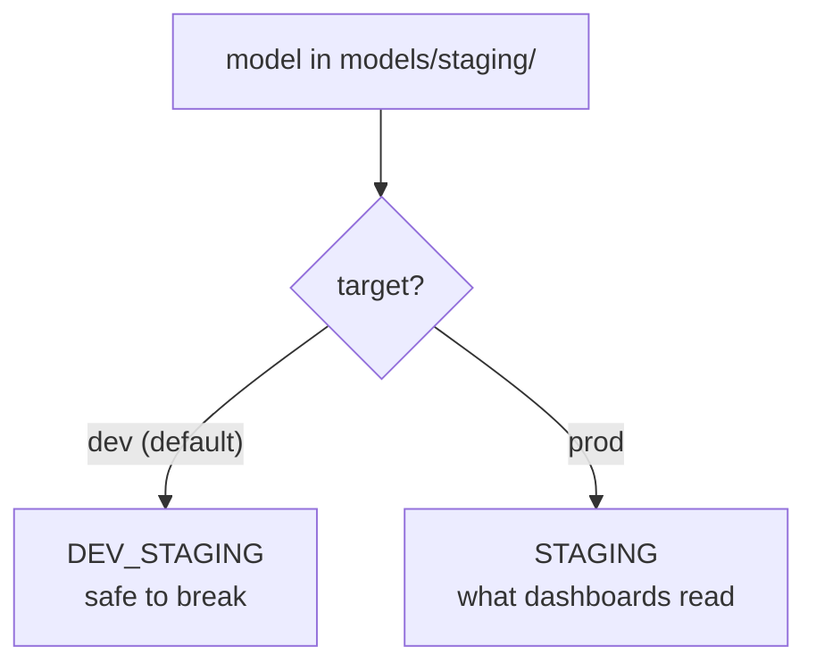

# dbt: set up dbt Core with Snowflake for a client project

**Category:** Data platform · **Time needed:** about 1 hour (15 install, 15 service user and key pair, 20 project files, 10 first run) · **Level:** first-timer friendly · **Last checked:** 10 November 2026

> **What this sets up.** dbt Core on your laptop, a dbt project in the client's repo and a key-pair service user in Snowflake that dbt signs in with. The project has two targets (dev and prod), declares the raw tables it reads as sources and runs a first set of tests.
>
> **Use it when** a client project already has a Snowflake account with RAW, STAGING and MARTS and a TRANSFORMER role (see [Snowflake: set up an account for a client project](../snowflake/set_up_account_for_client_project.md)) and the next job is turning raw data into clean tables and metrics.
>
> **You need:** Python on the laptop, admin access to Snowflake (to create a user), a password manager and the client's Git repo. **Permanent choices:** none. Everything here can be changed or rebuilt.

Scripts and files: [`dbt_service_user.sql`](dbt_service_user.sql) (step 3) and the starter files in [`starter/`](starter/) (step 5). Placeholders to replace: `CLIENT_PILOT` (database), `SVC_DBT` (service user), `orgname-accountname` (account identifier), `client_pilot` (dbt project name).

## Contents

1. [Words you need first](#1-words-you-need-first)
2. [Big picture](#2-big-picture)
3. [Before you start](#3-before-you-start)
4. [Steps](#4-steps)
5. [Gotchas](#5-gotchas)
6. [Checklist for next time](#6-checklist-for-next-time)
7. [Used on](#7-used-on)
8. [Learning log](#8-learning-log)

---

## 1. Words you need first

| Term | What it means in plain English |
| --- | --- |
| **dbt** | A tool that runs SQL `SELECT` statements in the warehouse in the right order and tests the results. The data never leaves Snowflake |
| **dbt Core** | The free, open-source version you run from a terminal (as opposed to dbt Cloud, the paid web version) |
| **Project** | A folder with a `dbt_project.yml` file and sub-folders of SQL and YAML files |
| **Model** | One `.sql` file holding one `SELECT`. dbt wraps it in `CREATE VIEW` or `CREATE TABLE` and names the result after the file |
| **Materialisation** | Whether a model is built as a view (always live, no storage) or a table (stored, fast to read) |
| **Source** | A table dbt reads but does not build, such as the raw tables. Declared once in a `.yml` file |
| **`source()` and `ref()`** | How a model names what it reads. dbt turns them into full table names and works out the build order from them |
| **Test** | A query that returns the rows breaking a rule. 0 rows means pass. Generic tests (`not_null`, `unique`) are one line of YAML; singular tests are `.sql` files |
| **Profile** | The connection settings (account, user, role, warehouse, key). Lives in `profiles.yml` on your laptop, never in the repo |
| **Target** | One set of connection settings inside a profile, such as `dev` or `prod` |
| **Service user** | A Snowflake login for a program, not a person. No password, no website sign-in |
| **Key pair** | Two matching files. The **private key** is secret and stays with dbt (like a house key); the **public key** is given to Snowflake (like the lock) |
| **Virtual environment (venv)** | A private folder of Python packages for one project, so installs never clash with other projects |

---

## 2. Big picture



Where models land in each target:



---

## 3. Before you start

- [ ] **Snowflake is set up** with a database, RAW, STAGING and MARTS schemas, a TRANSFORMER role that reads RAW and owns STAGING and MARTS, plus a small warehouse for it.
- [ ] **TRANSFORMER may create schemas** in the database (`GRANT CREATE SCHEMA ON DATABASE ... TO ROLE TRANSFORMER`), so dev schemas can be made.
- [ ] **Python** is installed. Check the Python versions dbt supports before you start; the newest Python is sometimes not supported yet (3.13 was used here while 3.14 was the newest).
- [ ] **Git** and the client's repo are on the laptop.
- [ ] **A password manager** for the private key.
- [ ] **OpenSSL** to make the key pair. Git for Windows includes it (`openssl` in Git Bash).

---

## 4. Steps

### Step 1. Install dbt in a virtual environment

In a terminal, in the repo's `dbt` folder (create it if needed):

```
py -3.13 -m venv .venv
.venv\Scripts\pip install dbt-core dbt-snowflake
.venv\Scripts\dbt --version
```

- **Why a venv:** dbt pulls in many packages. Keeping them in `.venv` means other Python projects are never affected; deleting the folder removes it all.
- **Pin the versions** once it works: save them in `requirements.txt` (for example `dbt-core==1.12.6` and `dbt-snowflake==1.12.5`), so everyone installs the same thing with `.venv\Scripts\pip install -r requirements.txt`.
- On macOS or Linux the paths are `.venv/bin/pip` and `.venv/bin/dbt`.

> `dbt --version` may say a newer major version is available or that a version is deprecated. Read it: pick a version that is still supported and note the choice in the project's docs.

### Step 2. Make the key pair (on the laptop)

In Git Bash, in a folder **outside the repo** (for example `C:\Users\<you>\secrets`):

```
openssl genrsa 2048 | openssl pkcs8 -topk8 -inform PEM -out svc_dbt_key.p8 -nocrypt
openssl rsa -in svc_dbt_key.p8 -pubout -out svc_dbt_key.pub
openssl rsa -pubin -in svc_dbt_key.pub -outform DER | openssl dgst -sha256 -binary | openssl enc -base64
```

- The first line makes the **private key** (`.p8`). The second makes the **public key** (`.pub`) from it. The third prints the public key's **fingerprint**, a short code you will compare in Snowflake.
- Save the private key in the password manager straight away: open the `.p8` in a text editor, copy everything and paste it into a secure note.
- **Never** put the `.p8` file in the repo. Add `*.p8`, `*.pem` and `profiles.yml` to `.gitignore`.

### Step 3. Create the service user in Snowflake

In Snowsight: **Projects → Worksheets → + → SQL Worksheet**. Paste block 1 of [`dbt_service_user.sql`](dbt_service_user.sql).

1. Open `svc_dbt_key.pub` in a text editor. Copy the lines **between** `-----BEGIN PUBLIC KEY-----` and `-----END PUBLIC KEY-----`, join them into one line and paste them in place of `<public key body>`.
2. Run the whole block: the arrow next to **Run** → **Run All** (Ctrl+Shift+Enter).
3. In the `DESC USER` result, check **TYPE** is `SERVICE`, **DEFAULT_ROLE** is `TRANSFORMER` and **RSA_PUBLIC_KEY_FP** is `SHA256:` followed by the fingerprint from step 2.
4. Put the placeholder back in the script before committing it, so the file never goes stale when the key is rotated.

**What each line does and why**

| Line | Why |
| --- | --- |
| `TYPE = SERVICE` | No password, no MFA prompt, no Snowsight sign-in. Only the private key gets in |
| `DEFAULT_ROLE = TRANSFORMER` and `GRANT ROLE` | dbt works with the least rights it needs: read RAW, build STAGING and MARTS |
| `STATEMENT_TIMEOUT_IN_SECONDS` | Stops a runaway query, a cost guard |
| `DEFAULT_SECONDARY_ROLES = ()` | Makes sure the user only ever has TRANSFORMER's rights (see Gotchas) |

### Step 4. Check the role sees the data

Run block 2 of the script **one statement at a time** (cursor in the line, Ctrl+Enter). It switches to TRANSFORMER with secondary roles off and counts the rows in a raw table. Write down what you expect **before** you run it. If the number is different, find out why before moving on (see Gotchas: "RAW keeps every file").

### Step 5. Create the project files

Copy the files from [`starter/`](starter/) into the repo's `dbt` folder and replace `client_pilot` and `CLIENT_PILOT`.

| File | What it does |
| --- | --- |
| `dbt_project.yml` | Names the project, says staging models are views in STAGING and mart models are tables in MARTS |
| `macros/generate_schema_name.sql` | In `prod`, builds into exactly `STAGING` and `MARTS`; in `dev`, into `DEV_STAGING` and `DEV_MARTS` |
| `models/staging/_sources.yml` | Declares the raw tables and puts `not_null` and `unique` tests on the columns you rely on |
| `profiles.example.yml` | The connection settings with no secrets. Copy it to `C:\Users\<you>\.dbt\profiles.yml` and set `private_key_path` |

Then make empty `models/marts`, `tests`, `seeds`, `snapshots` and `analyses` folders (add a `.gitkeep` file so Git keeps them).

**Why the macro:** dbt's default joins the target schema and the folder's schema, giving names like `STAGING_STAGING`. The macro keeps the names you chose; the `DEV_` prefix means trying things out never touches what dashboards read.

### Step 6. First run

From the `dbt` folder:

| Command | What it does | Expect |
| --- | --- | --- |
| `.venv\Scripts\dbt parse` | Reads every file and checks refs and YAML, without connecting | No errors |
| `.venv\Scripts\dbt debug` | Checks the profile and signs in to Snowflake | "All checks passed!" |
| `.venv\Scripts\dbt build` | Builds every model and runs every test, in order, into `dev` | Every source test passes (PASS = number of tests, ERROR=0) |
| `.venv\Scripts\dbt show --inline "select ..."` | Runs a quick query through dbt and prints it, without building anything | Handy for checking numbers |

With no models yet, `dbt build` only runs the source tests. That is enough to prove the sign-in, the role and the warehouse all work.

### Step 7. Commit

Commit the project files, `requirements.txt`, `profiles.example.yml` and the script with the placeholder. Before committing, check `git status` shows no `.p8`, no `profiles.yml`, no `.venv` and no `target` folder. Add to `.gitignore` if needed:

```
.venv/
dbt/target/
dbt/dbt_packages/
dbt/logs/
profiles.yml
*.p8
```

---

## 5. Gotchas

- **Secondary roles.** Snowsight turns on secondary roles for people, so a test query can quietly use the rights of every role you hold. Run `USE SECONDARY ROLES NONE;` after `USE ROLE` to see exactly what a role can do. Set `DEFAULT_SECONDARY_ROLES = ()` on service users.
- **RAW keeps every file.** If the upload process never overwrites (a good design), RAW holds replaced files too and row counts are higher than "one file per period". Staging models must read only the current files, usually by joining to an "uploads" or "current version" table.
- **Schema names doubled.** Without the `generate_schema_name` macro you get `STAGING_STAGING`.
- **A test that refers to a model that does not exist yet** stops `dbt parse`. Add `{{ config(enabled=false) }}` at the top until the model is built, with a comment saying when to remove it.
- **"Configuration paths ... do not apply to any resources".** A harmless warning while a folder in `dbt_project.yml` has no models yet. It goes when the first model is added.
- **Newest Python not supported.** If the install fails or warns, make the venv with an older Python (`py -0` lists the ones installed).
- **Version messages.** `dbt --version` can say a version is deprecated or that a new major version is the default. Decide on purpose and write it down; do not upgrade a major version mid-project without testing.
- **`profiles.yml` location.** dbt looks in `C:\Users\<you>\.dbt\` by default. Use `--profiles-dir` to point elsewhere.
- **One result at a time in Snowsight.** When several statements run together, only the last result shows. Run checks one by one with Ctrl+Enter.
- **Never paste the private key into chat, a ticket or a commit.** Refer to it by its file name.

---

## 6. Checklist for next time

- [ ] Python version dbt supports; venv made in the repo's `dbt` folder; versions pinned in `requirements.txt`
- [ ] Key pair made outside the repo; private key in the password manager; fingerprint noted
- [ ] Service user created (`TYPE = SERVICE`, role TRANSFORMER, timeout, no secondary roles); fingerprint matched; placeholder put back
- [ ] TRANSFORMER checked with secondary roles off; numbers explained
- [ ] Project files from `starter/` copied and renamed; `profiles.yml` in `.dbt`
- [ ] `dbt parse`, `dbt debug` and `dbt build` all clean
- [ ] `.gitignore` covers keys, `profiles.yml`, `.venv` and `target`; committed

---

## 7. Used on

- **A data pilot for a UK client (autumn 2026):** dbt Core 1.12 with Snowflake Enterprise, a key-pair service user with the TRANSFORMER role, synthetic data only. Set up in about an hour; the first build ran 7 source tests, all passed.

---

## 8. Learning log

Notes added each time this playbook is used, newest first. Versions and screens change, so check the date.

### 10 Nov 2026 · dbt Core 1.12.6, dbt-snowflake 1.12.5, Python 3.13

- **dbt only sends SQL.** For each model it writes `CREATE VIEW` or `CREATE TABLE ... AS SELECT` and runs them in the order the `ref()`s imply. The data never leaves Snowflake.
- **Prove the set-up before writing models.** A first `dbt build` with only sources and their tests checks the sign-in, the role and the warehouse in one go, in a few seconds of warehouse time.
- **`dbt show --inline`** is the quickest way to answer a question about the data. It uses the same login as dbt, so the answer also shows what the role can see.
- **Expected numbers can be out of date.** RAW kept earlier versions of replaced files, so the row count was higher than one file per period. Write down the expected number and why before running a check, then explain any difference before moving on.
- **One service user per tool.** dbt, an upload server, a BI tool and an MCP server each get their own user, one role and one key pair, with the private key in the password manager.
- **Version notices.** dbt Core 1.10 reported itself as deprecated at install time and 1.12 said dbt v2 is now the default for new installs. Pin a supported version and record the choice.
