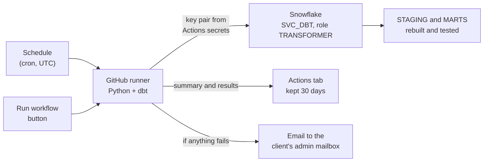
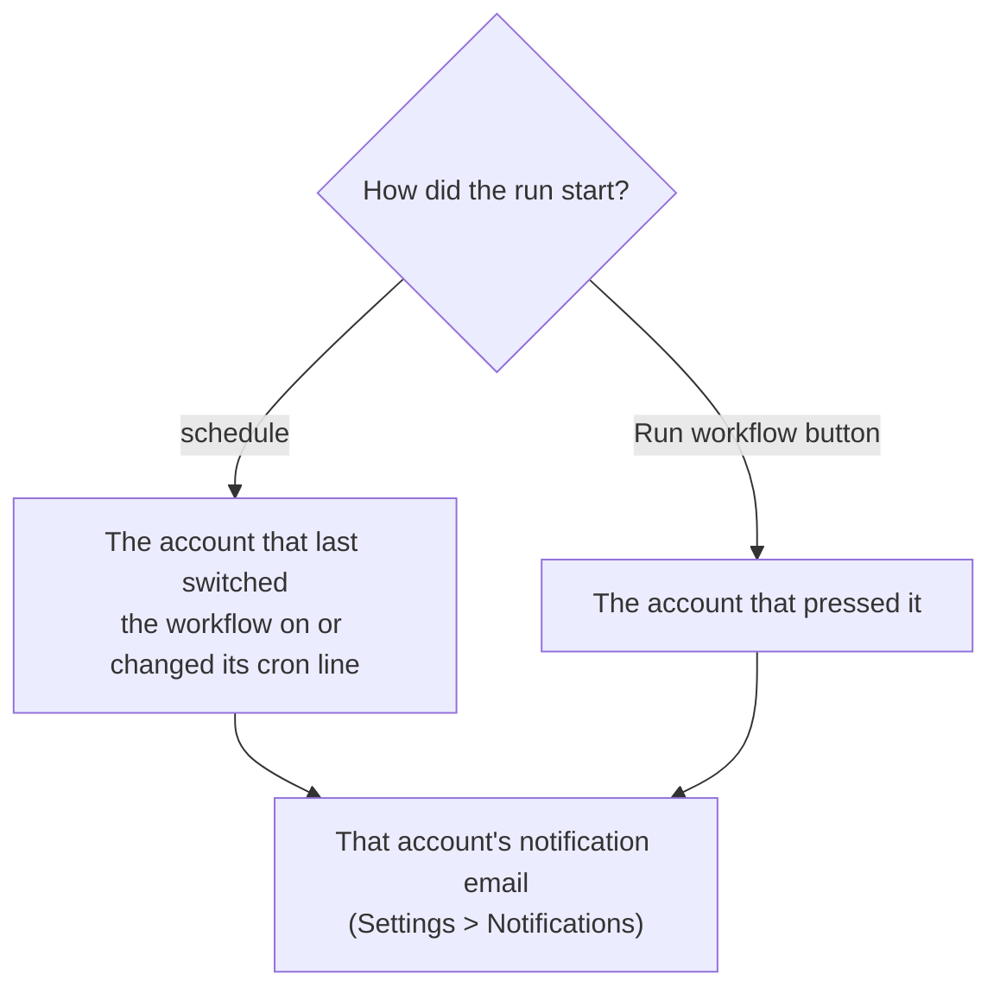

# GitHub Actions: run dbt on a schedule

**Category:** Data platform · **Time needed:** about 1 hour (10 workflow files, 10 secrets, 10 alert set-up, 15 first run and alert test, 15 cost check) · **Level:** first-timer friendly · **Last checked:** 27 November 2026

> **What this sets up.** A GitHub Actions workflow in the client's repo that runs `dbt build` against prod on a fixed day each month and whenever someone presses a button. It signs in to Snowflake as the dbt service user with its key pair, kept in GitHub Actions secrets. A failure turns the run red and emails the client's admin mailbox.
>
> **Use it when** dbt already runs from a laptop with a key-pair service user (see [dbt: set up dbt Core with Snowflake for a client project](../dbt/set_up_dbt_core_with_snowflake.md)) and the client wants the figures rebuilt and tested without anyone running dbt by hand.
>
> **You need:** the client's repo on GitHub (Owner or Admin), the dbt service user's private key (from the password manager), access to the client's admin mailbox and the GitHub account that uses it. **Permanent choices:** none. The workflow can be paused, changed or deleted at any time.

Starter files: [`starter/dbt_scheduled.yml`](starter/dbt_scheduled.yml) (the workflow) and [`starter/profiles.ci.yml`](starter/profiles.ci.yml) (the dbt profile for GitHub). Placeholders to replace: `client_pilot` (dbt profile name), `CLIENT_PILOT` (database), `SVC_DBT` (service user), `orgname-accountname` (account identifier), `client-admin` (the client's admin GitHub account) and `itadmin@client.example` (its email).

## Contents

1. [Words you need first](#1-words-you-need-first)
2. [Big picture](#2-big-picture)
3. [Before you start](#3-before-you-start)
4. [Steps](#4-steps)
5. [Gotchas](#5-gotchas)
6. [Checklist for next time](#6-checklist-for-next-time)
7. [Used on](#7-used-on)
8. [Learning log](#8-learning-log)

---

## 1. Words you need first

| Term | What it means in plain English |
| --- | --- |
| **GitHub Actions** | GitHub's built-in way to run commands for a repo, on GitHub's machines |
| **Workflow** | A recipe file in `.github/workflows/`. GitHub reads it and follows it |
| **Trigger** | What starts a workflow: here a schedule and a "Run workflow" button |
| **Cron** | A one-line way to write a schedule: minute, hour, day of month, month, day of week. GitHub reads it in **UTC** |
| **Runner** | A fresh Linux machine GitHub lends for one run and then throws away. Nothing is left on it afterwards |
| **Step** | One command or ready-made action. Steps run in order; if one fails the rest stop and the run goes red |
| **Secret** | A value typed into the repo's settings. Workflows can use it; nobody can read it back. GitHub shows `***` in its place in logs |
| **`workflow_dispatch`** | The trigger behind the "Run workflow" button. It can ask questions, such as a tick box |
| **Context** | A family of values a workflow can use, such as `secrets.*`, `github.*` or `runner.*`. Each is allowed only in certain places |

---

## 2. Big picture



Who gets the failure email:



---

## 3. Before you start

- [ ] **dbt runs from the laptop** with a key-pair service user: `dbt debug` passes and `dbt build --target prod` has been run at least once.
- [ ] **Versions are pinned** in `dbt/requirements.txt`, so GitHub installs exactly what the laptop has.
- [ ] **The service user has no IP limit** (no network policy) or one that allows GitHub's runners. GitHub-hosted runners have no fixed addresses; the key pair is the protection.
- [ ] **The private key is in the password manager.** You will paste it once into GitHub.
- [ ] **The client has an admin GitHub account** whose main email is their admin mailbox (`client-admin`, `itadmin@client.example`), with Admin rights on the repo. Failure emails will go to it.
- [ ] **The repo is private.** In a public repo GitHub switches schedules off after 60 days with no activity.
- [ ] **A day is agreed** for the run: after the month's data has arrived. If none is agreed yet, pick one, write it down as an assumption and say so.

---

## 4. Steps

### Step 1. Add the two files to the repo

1. Copy [`starter/dbt_scheduled.yml`](starter/dbt_scheduled.yml) to `.github/workflows/dbt_scheduled.yml`.
2. Copy [`starter/profiles.ci.yml`](starter/profiles.ci.yml) to `dbt/profiles.ci.yml` and rename `client_pilot` to the profile name in `dbt_project.yml`.
3. Change the cron line to your day. `"17 6 10 * *"` is 06:17 UTC on the 10th.
4. Check it locally without connecting: set six dummy environment variables, copy `profiles.ci.yml` to a temporary folder as `profiles.yml` and run `dbt parse --profiles-dir <that folder> --target prod`. No errors means dbt can read the profile.
5. Commit and push to the default branch.

**Why each choice**

| Choice | Why |
| --- | --- |
| A separate `profiles.ci.yml` | The laptop profile points at a key file. In GitHub there is no file: every value comes from a secret. It must not be called `profiles.yml`, which `.gitignore` usually blocks |
| Key passed as text (`private_key`), never written to disk | Nothing to clean up; GitHub masks it and the `DBT_ENV_SECRET_` prefix makes dbt mask it too |
| `concurrency: dbt-prod` | A button press during the scheduled run waits instead of building prod at the same time |
| `timeout-minutes: 30` | Stops a stuck run before it costs much |
| `permissions: contents: read` | The workflow only needs to read the repo |
| Query tag with the run number | Lets you find one run's queries and cost in Snowflake |
| A step that checks the secrets are set | A missing or misnamed secret fails at once with a clear message, instead of a confusing sign-in error |
| Alert test tick box | Proves the failure email arrives, without touching Snowflake |

**Check after pushing:** open the repo's **Actions** tab. The workflow should be listed with no red run. A red run labelled with your push and the message "This run likely failed because of a workflow file issue" means GitHub rejected the file (see Gotchas).

### Step 2. Add the six secrets

Repo **Settings → Secrets and variables → Actions → New repository secret**. Type each name exactly, paste the value, **Add secret**.

| Name | Value |
| --- | --- |
| `SNOWFLAKE_ACCOUNT` | `orgname-accountname` |
| `SNOWFLAKE_USER` | `SVC_DBT` |
| `SNOWFLAKE_ROLE` | `TRANSFORMER` |
| `SNOWFLAKE_WAREHOUSE` | The dbt warehouse |
| `SNOWFLAKE_DATABASE` | `CLIENT_PILOT` |
| `SNOWFLAKE_PRIVATE_KEY` | The whole private key, with its `BEGIN` and `END` lines |

To send the key without it ever being on screen or on the clipboard (PowerShell, with the GitHub CLI signed in):

```powershell
Get-Content -Raw "C:\path\to\svc_dbt_key.p8" | gh secret set SNOWFLAKE_PRIVATE_KEY -R owner/repo
```

**Check:** `gh api repos/owner/repo/actions/secrets --jq '.secrets[].name'` lists the six names in full. The web page and `gh secret list` can cut long names short, so a typo can hide there.

The five settings are not secret. Keeping them as secrets is fine, but they show as `***` in logs. Repository variables (`vars.*`) are the alternative if you want them readable.

### Step 3. Send failure emails to the client's admin mailbox

GitHub emails **one account** when a run fails (see the second diagram). Make that the client's admin account, not yours:

1. Sign in to GitHub as `client-admin`. Its main email (Settings → Emails) should be `itadmin@client.example`.
2. **Settings → Notifications → System → Actions:** tick **Email** and **Only notify for failed workflows**.
3. In the repo: **Actions → the workflow → ⋯ → Disable workflow**, then **Enable workflow**. The account that switches it back on now owns the schedule's emails.

**Why not add the admin email to your own account?** GitHub allows each email on one account only; if the admin account already uses it, you get "email is already in use". Having the client's own account own the schedule is better for handover anyway.

### Step 4. First run and alert test

Still as `client-admin`:

1. **Actions → the workflow → Run workflow → Run workflow.** Watch the steps. Expect `dbt debug` "All checks passed!" and `dbt build` ending `ERROR=0`.
2. Open the run: the summary table shows the counts; the file `dbt-results-<n>` at the bottom holds `run_results.json` and `dbt.log`.
3. Search the log for each setting's name: every value should show as `***`.
4. **Run workflow** again with **Alert test** ticked. Expect a red run within seconds and an email at `itadmin@client.example` within minutes.

### Step 5. Measure the cost of one run

Snowflake's usage views run up to 3 hours behind. Afterwards, in Snowsight:

```sql
-- Run with: ACCOUNTADMIN · the dbt warehouse · one statement at a time

-- a) The run's own queries
SELECT COUNT(*) AS queries,
       ROUND(SUM(execution_time) / 1000, 0) AS seconds_running
FROM SNOWFLAKE.ACCOUNT_USAGE.QUERY_HISTORY
WHERE query_tag = 'dbt_client_pilot_gha_<run number>';

-- b) The warehouse's credits in the hours of the run
SELECT start_time, credits_used_compute
FROM SNOWFLAKE.ACCOUNT_USAGE.WAREHOUSE_METERING_HISTORY
WHERE warehouse_name = '<dbt warehouse>'
  AND start_time >= '<run date> <hour before>:00:00'::TIMESTAMP_LTZ
ORDER BY start_time;
```

**Quick estimate before measuring:** an X-Small warehouse uses 1 credit an hour, billed by the second with a 60-second minimum. A run of N seconds, plus the warehouse's auto-suspend idle time, costs about (N + idle) ÷ 3,600 credits.

### Step 6. Write it down

In the client's docs: the schedule (in UTC and local time), the six secret names (never the values), which account owns the emails, where to see results, how to test the alert and the cost of one run. Add the secret names and the email owner to the client's GitHub handover file. Add the service user's second use (GitHub) to the Snowflake handover file, so a key rotation updates both places.

---

## 5. Gotchas

- **`runner.*` in job-level `env` breaks the whole file.** GitHub allows only some contexts in each place; job `env` may use `secrets` and `github` but not `runner`. The file is rejected: a red run appears on push with "likely failed because of a workflow file issue", no job runs and the **Run workflow** button disappears. Set such values inside a step and pass them on with `echo "NAME=value" >> "$GITHUB_ENV"`.
- **The workflow must be on the default branch** before the Run workflow button and the schedule appear.
- **Secrets cannot be renamed.** A typo in a name (for example a missing `KEY`) means adding it again under the right name and deleting the wrong one. Check the full names with the API (step 2).
- **Failure emails follow the cron line.** Whoever last edits it or last switches the workflow on gets the emails. After any edit by someone else, switch the workflow off and on as the client's admin account.
- **A run by hand emails whoever pressed the button.** Test the alert from the account that should receive it.
- **Cron is UTC.** 06:00 UTC is 06:00 in UK winter and 07:00 in summer. Scheduled runs can also start a few minutes late, more so at the top of the hour.
- **Public repos lose their schedules** after 60 days with no activity. Private repos do not.
- **Steps before checkout have no repo folder.** If the job's default `working-directory` is a folder in the repo, any step before `actions/checkout` needs `working-directory: .`.
- **Never echo a secret, even to debug.** Check that it is set with `[ -z "$VAR" ]` and print only its name.
- **Usage views lag.** Measure cost a few hours after the run, not straight away.

---

## 6. Checklist for next time

- [ ] dbt runs from the laptop; versions pinned; no IP limit on the service user (or one that allows GitHub)
- [ ] `dbt_scheduled.yml` and `profiles.ci.yml` copied, renamed and the cron day chosen; `dbt parse` with dummy values clean; pushed to the default branch
- [ ] No red "workflow file issue" run after the push
- [ ] Six secrets added; names checked in full with the API
- [ ] Client's admin account: Actions emails for failures on; workflow switched off and on by it
- [ ] First run by hand green; secrets show as `***` in the log
- [ ] Alert test red; email arrived at the admin mailbox
- [ ] Cost of one run measured; schedule, secret names, email owner and cost written in the docs and handover files

---

## 7. Used on

- **A data pilot for a client (autumn 2026):** monthly `dbt build` against prod with dbt Core 1.12 and Snowflake Enterprise on an X-Small warehouse, key-pair service user with the TRANSFORMER role, synthetic data only. The first run by hand built and tested the whole project in under two minutes with no errors.

---

## 8. Learning log

Notes added each time this playbook is used, newest first. Versions and screens change, so check the date.

### 27 Nov 2026 · GitHub Actions, dbt Core 1.12.6, dbt-snowflake 1.12.5, Python 3.13

- **Read the error GitHub gives on push.** The first version used `${{ runner.temp }}` in the job's `env`. GitHub rejected the file without running anything. The Run workflow button disappeared until it was fixed. Moving the value into a step fixed it.
- **The secrets page can hide a typo.** A key saved under a name one word short looked right at a glance; listing the names with the API showed it.
- **Reuse the laptop's service user.** The same user, role and warehouse as on the laptop meant no new rights in Snowflake: only the private key gained a second home, which the handover files now say, so a key rotation updates both.
- **"Email is already in use" was a good sign.** The client's admin mailbox already belonged to the client's own GitHub account, so that account took over the schedule (switch off and on) instead of routing email from a consultant's account.
- **The whole run costs very little.** About 85 seconds of dbt on an X-Small warehouse plus the 60-second auto-suspend: an estimated 0.04 credits a run.
