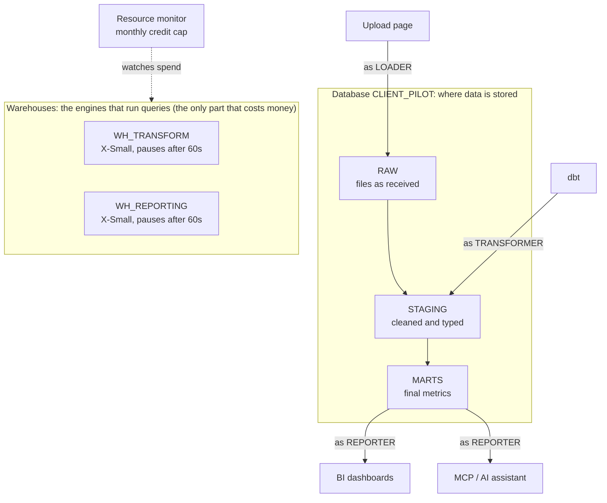
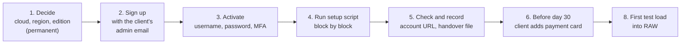
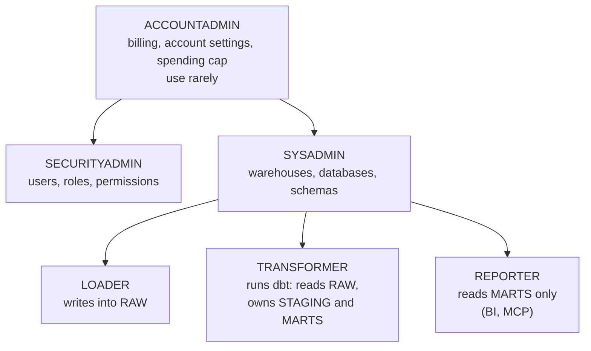
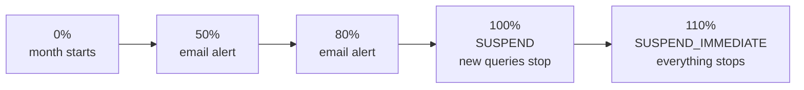
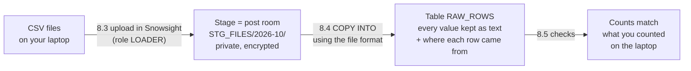

# Snowflake: set up an account for a client project

**Category:** Data platform · **Time needed:** about 45 minutes (10 sign-up, 5 activation, 30 setup script), plus about 30 minutes for a first test load · **Level:** first-timer friendly · **Last checked:** 4 November 2026

> **What this sets up.** A Snowflake account owned by the client, with a monthly spending cap, three job roles, two small self-pausing warehouses and a database with RAW, STAGING and MARTS layers, ready for dbt, a BI tool (such as Tableau) and an MCP server. Then a first test load of CSV files into RAW.
>
> **Use it when** a client project needs a cloud data warehouse, from a pilot upwards.
>
> **You need:** a client admin email, a password manager and the client's agreement to the terms. **Permanent choices:** cloud, region and edition.

Scripts: [`account_setup.sql`](account_setup.sql) (steps 4 to 7) and [`test_load_raw.sql`](test_load_raw.sql) (step 8). Placeholders to replace: `CLIENT_PILOT` (database), `ITADMIN` (admin user), `RM_CLIENT_PILOT_MONTHLY` (spending cap).

## Contents

1. [Words you need first](#1-words-you-need-first)
2. [Big picture](#2-big-picture)
3. [Before you start](#3-before-you-start)
4. [Steps](#4-steps)
5. [Gotchas](#5-gotchas)
6. [Checklist for next time](#6-checklist-for-next-time)
7. [Used on](#7-used-on)
8. [Learning log](#8-learning-log)

---

## 1. Words you need first

| Term | What it means in plain English |
| --- | --- |
| **Account** | Your company's own Snowflake. Has a URL like `orgname-accountname.snowflakecomputing.com` |
| **Snowsight** | The web interface where you click around and write SQL |
| **Worksheet** | A page in Snowsight where you type and run SQL |
| **Warehouse** | The engine that runs queries. It is the only part that really costs money, and only while it is running. Sizes go X-Small, Small, Medium and up; each size doubles the cost |
| **Credit** | Snowflake's unit of spend. An X-Small warehouse uses 1 credit per hour, billed per second |
| **Database / schema** | A database is a container; schemas are folders inside it; tables live in schemas |
| **Role** | A bundle of permissions. You switch roles to do different jobs |
| **Resource monitor** | A spending cap counted in credits, with alerts and automatic stops |
| **Time Travel** | An undo window: you can recover changed or dropped data for a set number of days |
| **Stage** | A landing folder for files, inside Snowflake (internal) or in cloud storage (external). Files go here before they are loaded into a table |
| **File format** | A saved set of rules for reading files (CSV, separator, header, encoding) |

---

## 2. Big picture



The journey in stages:



---

## 3. Before you start

- [ ] **A client-owned admin email** (for example `itadmin@client.example`). Never your own address: the client must own the account.
- [ ] **The client's agreement to Snowflake's standard terms.** Ticking the terms box accepts them on the client's behalf.
- [ ] **A password manager** to store the admin login and its MFA, so someone else can take over later.
- [ ] **The three permanent decisions** below, agreed with the client.

> **Warning: cloud, region and edition are chosen at sign-up and cannot be changed later.** Changing any of them means a new account and moving everything.

| Decision | Options | What we recommend and why |
| --- | --- | --- |
| **Cloud** | AWS, Azure, Google Cloud | **AWS**, unless the client is a Microsoft or Google shop. It has the widest feature coverage |
| **Region** | Dozens worldwide | **Where the data must live.** For UK data: AWS Europe (London), eu-west-2. Region also affects the price per credit |
| **Edition** | Standard, Enterprise, Business Critical | **Enterprise** if you will ever need row-level security, column masking or 90-day Time Travel. Standard is cheaper per credit but lacks those |

---

## 4. Steps

### Step 1. Sign up (page 1 of 2)

Go to [signup.snowflake.com](https://signup.snowflake.com). Fill in:

- **First and last name:** use a role, not a person: `IT` / `Admin`. The account outlives whoever sets it up.
- **Work email:** the client's admin address.
- **Why are you signing up?** Anything. It only feeds Snowflake's marketing.
- Click **Continue**. Nothing is created yet.

> Skip "Sign up with Google / Microsoft". It ties the account to whoever is signed in to the browser, not to the client's admin email.

### Step 2. Sign up (page 2 of 2): the permanent choices

- **Company name:** the client's legal name.
- **Job title:** `IT Administrator`.
- **Edition, cloud provider, region:** as decided above. Check them twice.
- Tick the terms box (with the client's OK) and click **Get started**. The account is created and the 30-day trial starts now.
- A short survey follows ("preferred languages"). It has no effect: pick SQL and Python, or Skip.

### Step 3. Activate (the human does this)

1. Open the admin inbox. Snowflake sends an activation email within a few minutes.
2. Click the link. Choose a **username** (we use `ITADMIN`) and a strong **password**. Save both in the password manager straight away.
3. Set up **MFA** when asked. For a shared admin login, keep the MFA in the password manager so a future admin can get in.
4. You land in **Snowsight**.

> AI assistants should never type passwords or MFA codes. The assistant fills in forms and explains; you do the credentials.

### Step 4. Run the setup script, one block at a time

In Snowsight: **+ Create → SQL Worksheet**. Paste [`account_setup.sql`](account_setup.sql), then **select one block with the mouse and press Ctrl+Enter** to run only that block. Read the result before moving on. Change `CLIENT_PILOT`, `ITADMIN` and the credit quota to suit the client first.

**What each block does and why**

| Block | Runs as | What it does | Why it matters |
| --- | --- | --- | --- |
| 1. Account basics and spending cap | ACCOUNTADMIN | Local time zone; resource monitor with alerts at 50% and 80%, suspend at 100%, hard stop at 110%; applied to the whole account | Default time zone is US Pacific. The cap means a forgotten warehouse can never run up a bill |
| 2. Roles | SECURITYADMIN | Creates LOADER, TRANSFORMER and REPORTER, hangs them under SYSADMIN and grants them to the admin user | One role per job: each tool only gets what it needs |
| 3. Warehouses | SYSADMIN | Two X-Small warehouses that pause after 60 seconds, wake on demand and start paused | Smallest size, no idle cost. Two warehouses let you measure build cost and dashboard cost separately |
| 4. Database and layers | SYSADMIN | Database with 7-day Time Travel; schemas RAW, STAGING, MARTS; STAGING and MARTS handed to TRANSFORMER | dbt must own the schemas it builds into |
| 5. Access | SECURITYADMIN | Links roles to layers, including FUTURE grants | New tables dbt creates are readable automatically; REPORTER can never see RAW |
| 6. Check | ACCOUNTADMIN | SHOW commands | Proves it all exists |



How the spending cap steps in during a month:



### Step 5. Check and record

- Every block should end with "Statement executed successfully" or "… successfully created". Block 6 lists what exists.
- **Turn on the spending alerts:** bottom-left name → **Settings**. Under **Profile**, check the email shows no "unverified" warning (clicking the activation link usually verifies it already; if not, use Resend verification email). Then under **Notifications → Cost management**, switch on **Receive email notifications from resource monitors**. Without both, the 50% and 80% emails never arrive.
- **Record the account URL:** bottom-left name → hover the account → **View account details**. The window lists the account identifier (`ORG-ACCOUNT`, what dbt and BI tools ask for), the account URL, the locator, cloud and edition, each with a copy button. Or run `SELECT CURRENT_ORGANIZATION_NAME(), CURRENT_ACCOUNT_NAME();` and build `https://org-account.snowflakecomputing.com`. It is not a secret, but keep it in the client's records rather than in public places.
- Write the platform's handover file (accounts, URL, settings, where credentials are kept, never the credentials themselves).
- Save the script in the client's repo so the setup can be repeated.

### Step 6. Before day 30: payment details

The trial runs **30 days or $400 of credits, whichever comes first**, and needs no card. Before it ends, the client adds a payment card (Admin → Billing) so Snowflake bills the client directly. Put it in the plan as a client task with a date a few days before the end.

### Step 7. Everyday use: always set role and warehouse

> **Before running anything, check the role and warehouse.** The **role** decides what you are allowed to do and who owns what you create. The **warehouse** decides what gets billed.

Every query in our notes starts with a **Run with** line, for example:

> **Run with:** role `SYSADMIN` · warehouse `WH_TRANSFORM` · database `CLIENT_PILOT` (only if needed)

Set both in the worksheet menus or in SQL with `USE ROLE …;` and `USE WAREHOUSE …;`.

**Which warehouse for what**

| Warehouse | Use it for |
| --- | --- |
| **WH_TRANSFORM** | Setting things up, loading data, dbt, any query that changes data |
| **WH_REPORTING** | Looking at results, testing what the BI tool or the MCP will see |
| COMPUTE_WH, SNOWFLAKE_LEARNING_WH, SYSTEM$STREAMLIT… | Created by Snowflake at sign-up. Not used for project work |

**Which role for what**

| Role | Use it for |
| --- | --- |
| **SYSADMIN** (our default) | Everyday work: warehouses, databases, schemas, tables |
| **SECURITYADMIN** | Creating roles and users, giving permissions |
| **ACCOUNTADMIN** | Only for account-level things: billing, spending cap, account settings, objects Snowflake created itself |
| LOADER, TRANSFORMER, REPORTER | Doing that job, or testing what each tool can see (switch in, run a query, switch back) |

> **What costs money and what does not.** Commands that only read or change settings (`SHOW`, `ALTER`, `GRANT`, `CREATE ROLE`, `USE`, `LIST`) do not use a warehouse and cost nothing. A warehouse only starts when a query has to read or process data, and then bills per second (minimum 60 seconds) until it pauses.

**Tidy up after sign-up (one-off)**

A new admin user starts every session as ACCOUNTADMIN, and Snowflake's own warehouses pause slowly. Fix both:

> **Run with:** role `ACCOUNTADMIN` · warehouse: any (settings only, no compute)

```sql
USE ROLE ACCOUNTADMIN;
ALTER USER ITADMIN SET DEFAULT_ROLE = SYSADMIN;
ALTER USER ITADMIN SET DEFAULT_WAREHOUSE = WH_TRANSFORM;
ALTER WAREHOUSE COMPUTE_WH            SET AUTO_SUSPEND = 60;
ALTER WAREHOUSE SNOWFLAKE_LEARNING_WH SET AUTO_SUSPEND = 60;
SHOW WAREHOUSES;   -- check the auto_suspend column says 60 for every warehouse
```

We use ACCOUNTADMIN here because Snowflake created its own warehouses, so SYSADMIN may not own them.

### Step 8. First test load into RAW

**Why do this.** Before building anything on top (dbt models, dashboards, an AI assistant), prove that the client's files load into Snowflake exactly as they are. If something in the file format breaks, it is far cheaper to find out now with test files than later with real data.

**What you need:** the setup script from step 4 already run; one month of test files (made-up data, never real data for a first test) in a folder on your laptop; the script [`test_load_raw.sql`](test_load_raw.sql) open in a Snowsight worksheet. Allow about 30 minutes the first time.

**The idea in one picture.** Loading a file is like receiving a parcel: it is delivered to a **post room** first (the **stage**), then someone **unpacks** it onto the shelves (`COPY INTO` puts the rows into a **table**), following a set of **unpacking instructions** (the **file format**). Finally you **count what arrived** against the delivery note (the checks).



> **Run with** (for the whole step, unless a sub-step says otherwise): role `LOADER` · warehouse `WH_TRANSFORM` · database and schema `CLIENT_PILOT.RAW`

> **How to run one statement.** Click anywhere inside it and press **Ctrl+Enter** (Cmd+Enter on a Mac). Snowsight runs only the statement under the cursor, from its first word to its semicolon. To run several lines, highlight them first. If you run many statements at once, Snowsight shows **only the last result**, so for checks always run one at a time.

#### 8.1 Count your files before you load them

Do this first, so you have a "delivery note" that does not come from Snowflake. If Snowflake later shows the same numbers, you know nothing was lost or changed on the way in. For each file, note:

- the number of rows (lines in the file minus the header line)
- how many rows have a value in any optional column (for example a refund date)
- whether any file is missing an optional column altogether

You can do this in Excel (open each file and look at the row number of the last row, minus one) or with a few lines of Python:

```python
import csv, glob
total = 0
for f in sorted(glob.glob("2026-10/*.csv")):
    rows = list(csv.DictReader(open(f, encoding="utf-8")))
    filled = sum(1 for r in rows if r.get("refund_date"))
    print(f, len(rows), "rows,", filled, "refund dates,", len(rows[0]), "columns")
    total += len(rows)
print("TOTAL", total)
```

Put all the month's files in one folder, for example `2026-10`, so you can upload them together.

#### 8.2 Create the file format, stage and table (blocks 1 to 4)

Run blocks 1 to 4 of the script one at a time. Each should answer "… successfully created" (or "already exists", which is fine on a rerun). None of them uses a warehouse, so they cost nothing.

| Block | What it creates | In plain English |
| --- | --- | --- |
| 1 · Context | Nothing; sets role, warehouse, database and schema | "This is who I am and where I am working" |
| 2 · File format `FF_CSV` | Reading rules for your CSVs | Comma-separated, first line holds the column names, blanks become empty (NULL). Because it reads the names, columns can arrive in any order and an optional column can be missing |
| 3 · Stage `STG_FILES` | A private, encrypted folder inside Snowflake | The post room where files wait before they are loaded |
| 4 · Table `RAW_ROWS` | A table with every column as text, plus `SOURCE_FILE`, `SOURCE_ROW` and `LOADED_AT` | RAW keeps exactly what arrived. Nothing is rejected because a value "looks wrong"; tidying happens later in STAGING. The three extra columns record which file and line each row came from, and when |

#### 8.3 Upload the files to the stage

This part is done with the mouse, not SQL.

1. Bottom left of Snowsight, check the role says **LOADER**. If not, click your name and switch role. The stage belongs to LOADER, so other roles cannot upload to it.
2. In the left menu go to **Ingestion → Add data → Load files into a Stage**.
3. Choose the schema `CLIENT_PILOT.RAW` and the stage `STG_FILES`.
4. Click **Browse**, open your month folder, select all the files (Ctrl+A) and click **Open**. Check they are all listed.
5. In "Specify the path", type the month, for example `2026-10`. This creates a folder of that name inside the stage, so each month stays separate.
6. Click **Upload**. Small files take a few seconds.

Back in the worksheet, check they arrived:

```sql
LIST @STG_FILES/2026-10/;
```

You should see one row per file, with its name, size and an `md5` code (a fingerprint of the file's contents). The number of rows must equal the number of files you uploaded. `LIST` is free: it only reads information about the files.

#### 8.4 Copy the files into the table (block 5)

Run the `COPY INTO` statement. This is the actual load, and the first statement that wakes the warehouse (for a few seconds; it costs a tiny fraction of a credit).

What its options mean:

| Option | In plain English |
| --- | --- |
| `MATCH_BY_COLUMN_NAME` | Put each column of the file into the table column with the same name |
| `INCLUDE_METADATA` | Fill in `SOURCE_FILE`, `SOURCE_ROW` and `LOADED_AT` for every row |
| `ERROR_ON_COLUMN_COUNT_MISMATCH = FALSE` | Needed because the table has more columns than the files (the three extra ones). Side effect: a badly built row with too many or too few commas is not stopped here, so whatever sends files in (an upload page, a script) must check that before |
| `ON_ERROR = ABORT_STATEMENT` | All or nothing: if any row cannot be read, nothing is loaded and you get the reason |

**What you should see:** one result line per file, each with status **LOADED** and the number of rows it loaded. If a file shows an error, read the message in `first_error`: it names the file, the line and what was wrong.

#### 8.5 Check the load (block 6)

The checks answer one question: **did exactly what was in the files arrive in the table, once, and can the next stage use it?** Run them one at a time and compare each answer with what you counted in 8.1.

| Check | The question it answers | What you should see | Why it matters |
| --- | --- | --- | --- |
| **6a · Rows per file** | Did every file arrive whole? | One line per file, with the same row count you noted in 8.1 | A file cut short would quietly undercount everything built on it |
| **6b · Totals** | Did anything get duplicated or garbled? | Total rows = your total; unique IDs = total rows (no duplicates); one month; the same count of filled optional values; `0` values that fail to read as a number | Duplicates inflate every figure; a number that cannot be read breaks every sum and average later |
| **6c · The file missing an optional column** | Does a file without that column still load? | Its rows are all there, and the optional column is empty (NULL) for all of them | Proves the file format's flexibility really works, not just on paper |
| **6d · Ten rows** | Does it look right, and is every row labelled? | Sensible values; `SOURCE_FILE`, `SOURCE_ROW` and `LOADED_AT` filled in | The label is how you answer "where did this number come from?" months later |
| **6e · Load history** (`COPY_HISTORY`) | Does Snowflake keep its own record of the load? | One line per file, status **Loaded**, with row counts | Your audit trail: what was loaded, when, and whether it worked |
| **6f · Run the COPY again** | If the same file is sent twice, is it counted twice? | "Copy executed with 0 files processed", and 6b still shows the same total | Snowflake remembers loaded files for 64 days and skips them, so a resend cannot double the numbers |
| **6g · Read as TRANSFORMER** | Can the next stage (dbt) read the table without extra setup? | The same total row count | Proves the access rules from step 4 work for tables created later |

In short: **6a to 6c** prove the data came in correctly, **6d and 6e** prove it can be traced, **6f** proves it is protected against duplicates and **6g** proves the next stage can use it.

**For 6g**, highlight the first two lines (`USE ROLE TRANSFORMER;` and the `SELECT COUNT(*)`) and run them together: the result shown is the count. Then run `USE ROLE LOADER;` on its own to switch back.

#### 8.6 If something does not match

- **A file is missing from `LIST`:** upload it again to the same folder, then rerun the COPY. Only the new file is loaded.
- **The COPY stops with an error:** nothing was loaded (all or nothing). Fix the file named in the message, upload it again (same name replaces the old one) and rerun the COPY.
- **A count in 6a or 6b differs from 8.1:** first check your own count (header line, blank last line). If Snowflake really has fewer rows, look at that file's line in 6e.
- **You want to start again from empty:** run `TRUNCATE TABLE RAW_ROWS;`, then run the COPY once with `FORCE = TRUE` added before the semicolon. Without `FORCE`, Snowflake skips the files it remembers loading.

#### 8.7 Record it

Save the script in the client's repo, write a short note of what you loaded and the check results, and note anything that broke and what was done about it. That note is the proof, for you and the client, that the file format works.

---

## 5. Gotchas

> **Permanent choices.** Cloud, region and edition cannot be changed after sign-up.

- **Do not build with ACCOUNTADMIN.** Objects belong to whichever role created them. Create roles with SECURITYADMIN and objects with SYSADMIN, so admins can manage them later.
- **Grant roles up to SYSADMIN.** Otherwise SYSADMIN cannot see what those roles create.
- **Use FUTURE grants.** dbt rebuilds tables often; without future grants, the BI tool loses access after every run.
- **Alerts need a verified email.** The resource monitor can only email users whose address is verified.
- **The trial clock.** It starts at "Get started", not when you first log in.
- **Shared admin login and MFA.** Keep the MFA where a successor can reach it (password manager), or the account can get locked to one person's phone.
- **Snowflake creates its own warehouses at sign-up.** COMPUTE_WH and SNOWFLAKE_LEARNING_WH pause slowly. Set them to 60 seconds and run project work on your own warehouses.
- **Default role.** A new admin user starts every session as ACCOUNTADMIN. Change it to SYSADMIN.
- **Always know your role and warehouse** before running anything.
- **Upload as the stage's owner.** Snowsight uploads with the role shown bottom left; switch to the role that owns the stage first.
- **One result at a time.** When several statements run together, Snowsight shows only the last result. Run checks one by one.
- **`INCLUDE_METADATA` with CSV** needs `ERROR_ON_COLUMN_COUNT_MISMATCH = FALSE`, so the COPY will not stop a row with the wrong number of fields. Check that before files reach the stage.
- **Form quirks.** The sign-up dropdowns can jump when the page resizes. Check what was actually selected before continuing.

---

## 6. Checklist for next time

- [ ] Client admin email exists and you can reach its inbox
- [ ] Client agreed: cloud, region, edition, standard terms
- [ ] Signed up as "IT Admin" with the client's email (not Google or Microsoft sign-in)
- [ ] Activated: username, password and MFA saved in the password manager
- [ ] Script run block by block; Block 6 shows everything
- [ ] Admin email verified (for alerts)
- [ ] Default role set to SYSADMIN; Snowflake's own warehouses set to pause after 60 seconds
- [ ] Account URL recorded; handover file written; script committed to the client's repo
- [ ] Client task dated: add payment card before day 30
- [ ] First test load into RAW done and every check matched

---

## 7. Used on

- **A data pilot for a UK client (autumn 2026):** Enterprise, AWS Europe (London), a monthly cap of 25 credits, synthetic data only during the pilot. Account set up in the first week; a first test load of one month of synthetic files (12 files, about 5,500 rows) a week later, every check matched.

---

## 8. Learning log

Notes added each time this playbook is used, newest first. Screens and menus change, so check the date.

### 4 Nov 2026 · Loading CSV files into RAW

- **A load has three parts.** A **file format** (saved reading rules), a **stage** (a private landing folder inside Snowflake) and `COPY INTO`, which reads staged files into a table. Files go into the stage first; nothing reaches the table until the COPY runs.
- **Uploading files has moved.** It is now **Ingestion → Add data → Load files into a Stage** (not Data → Databases). Pick the schema and stage, Browse for the files and type a folder path (one folder per month works well, e.g. `2026-10`). Switch to the role that owns the stage first (bottom left).
- **LIST shows what is in a stage.** `LIST @STAGE/folder/;` gives each file's name, size and checksum. Metadata only, no warehouse.
- **Match columns by name.** `PARSE_HEADER = TRUE` in the file format plus `MATCH_BY_COLUMN_NAME` in the COPY copes with columns in a different order or an optional column missing (it is left NULL).
- **Label every row with its source.** `INCLUDE_METADATA` fills columns such as file name, row number and load time. With CSV it needs `ERROR_ON_COLUMN_COUNT_MISMATCH = FALSE`, so rows with the wrong number of fields must be caught before the file is staged.
- **Reruns are safe.** Snowflake remembers which files it has loaded (64 days) and skips them: "Copy executed with 0 files processed". To reload on purpose, empty the table and add `FORCE = TRUE` once.
- **Run checks one at a time.** When several statements run together, Snowsight shows only the last result. Put the cursor in one statement and press Ctrl+Enter.
- **Check a load against numbers worked out separately** (rows per file, unique IDs, blanks, values that should be numbers), plus `COPY_HISTORY` for Snowflake's own record.

### 2 Nov 2026 · Spending alerts

- **Two switches for alerts.** The email must be verified (Settings → Profile) and "Receive email notifications from resource monitors" must be on (Settings → Notifications → Cost management).
- **No warning means verified.** Profile only shows a "Resend verification email" button when the email is not verified yet.
- **Snowsight remembers your last role.** The default role applies to new sessions, but the bottom-left corner shows the role you last used. Check it before running anything.
- **The trial meter** sits bottom left: credits left and days to the end of the trial.

### 30 Oct 2026 · New account basics

- **Role and warehouse first.** They decide what you can do (role) and what gets billed (warehouse). Check them before every run.
- **Settings are free, data work is not.** SHOW, ALTER, GRANT, CREATE ROLE and USE need no warehouse. Only queries that read or process data start one.
- **Snowflake adds its own warehouses** at sign-up (COMPUTE_WH, SNOWFLAKE_LEARNING_WH, a Streamlit one) with slower pause times. Set them to 60 seconds and do project work on your own warehouses.
- **The default role starts as ACCOUNTADMIN.** Changing it to SYSADMIN avoids building things with the most powerful role by accident.
- **Run one block at a time.** Select the lines and press Ctrl+Enter, then read the result before moving on.
- **Account details** are under your name (bottom left) → hover the account → View account details. The account identifier (ORG-ACCOUNT) is what dbt and BI tools ask for.
- **Default warehouse.** Set it to your own working warehouse with `ALTER USER … SET DEFAULT_WAREHOUSE = WH_TRANSFORM;` so new worksheets start on it. Picking a warehouse in the menu only changes that one worksheet.
- **Worksheets live in "My Workspace"** (left panel). Name them so they are easy to find, for example "01 account setup.sql".
